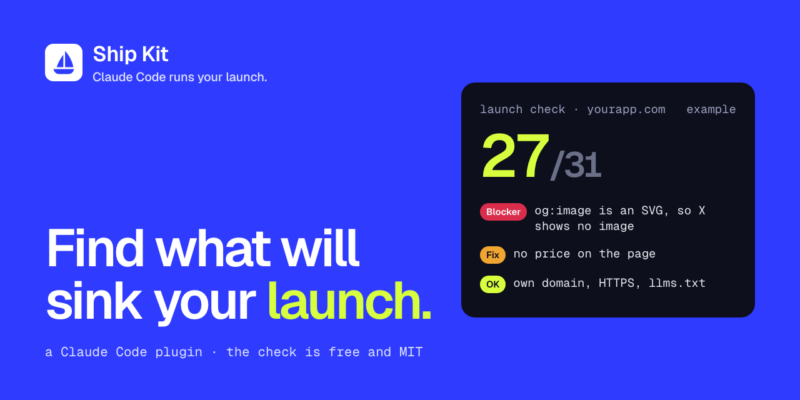

<p align="center"></p>

# Ship Kit

**Claude Code runs your launch.** Ship Kit is the launch check for Claude Code. It finds what will hurt your launch, with the file and line for each fix, and Pro writes posts that don't read like AI. It's for people who can build an app in a weekend and then freeze at "now post it".

Nothing broken on launch day.

This repo is the free half: three commands that work on any project.

| Command | What you get |
|---|---|
| `/shipkit:check` | A launch pre-flight: 24 checks on your repo and your landing page, live or still local, each with its evidence and the exact fix. The share preview check reads your real OG image: its type, pixel size, shape and file weight. |
| `/shipkit:page` | A landing page written from your repo: one HTML file in your brand, using your real screenshots and real facts, plus the share image, `llms.txt`, `sitemap.xml` and `robots.txt`. |
| `/shipkit:lint` | A second reader for any launch post. A linter flags AI and hype tells. An independent critic reads the post as that platform's crowd. Then it's checked against the subreddit's dated rules: self-promotion, AI-written posts and banned product types. You get a verdict, a score, the weakest line and fixes in your own words. |

It never posts, deploys or signs up for anything. Everything it writes goes in `.shipkit/` in your project.

## Why it exists

Launching is a second job. You need the page, the posts for every platform and their rules, the timing, the links and the checks. Most of it gets done at 2 AM the night before.

The marketing skill packs I tried teach launch frameworks. Ship Kit looks at *your* launch: it reads your repo and your live site, then hands you the fixes and the finished files. I built it while launching my own Mac app, Afterword, and ran it on that launch first.

## Install

In Claude Code:

```
/plugin marketplace add kiznnnn/shipkit
/plugin install shipkit@shipkit
```

You'll need Node 18 or newer for the check's site probe and the copy linter. Neither has any dependencies.

## Use

Open your project in Claude Code and type:

```
/shipkit:check
```

You get `.shipkit/check.md`: blockers, fixes for this week, what's already good, the questions only you can answer, and a table of every check with its verdict and evidence. It ends in a one-line score you can share (`Launch check: <passed>/<scored>`), and it writes that run's share card to `.shipkit/score-card.png` (1200×630, with your score and the top two findings). Run it again after you fix things and it shows what changed.

### What it checks

24 items in seven groups. The full list, with why each matters, is in [`skills/check/references/checklist.md`](skills/check/references/checklist.md).

| Group | Checks |
|---|---|
| Trust | own domain, HTTPS and redirects, the download opens without a scare, privacy/terms/contact |
| First 5 seconds | the hero says the outcome, the real product above the fold, a way to try it now, **the share preview and its image** |
| The offer | price on the page, a free start plus pay-now, real scarcity, abuse limits on free offers |
| Measurement | analytics, UTM links per channel |
| Distribution | Reddit karma, Show HN eligibility, a sound-off launch video, a share loop, trusted directories |
| Findability | title/description/canonical/noindex/sitemap, `llms.txt`, AI crawlers in robots.txt and JSON-LD |
| Launch week | an update path and changelog, the shipped build is launch-tested |

The share preview check opens the actual image your `og:image` points to and reports its type, size in pixels, shape and file weight: SVGs that X won't show, square images that get cropped, files over X's 5 MB limit, relative URLs, a missing `summary_large_image` card.

### Does my page have to be live?

No. Point it at the folder or file and it reads the page from disk, share image included:

```
/shipkit:check my site isn't deployed yet, check ./public
```

### Does it work on a private repo?

Yes. Ship Kit has no server. It runs inside your own Claude Code session, and the check only sends GET requests to your own public site (none at all when it reads local files).

### The other two

```
/shipkit:page
```

You get `.shipkit/page/index.html` plus the share image, `llms.txt`, `sitemap.xml` and `robots.txt`. It runs the same probe on its own output before handing it over. Open it, react to the words, and ship it wherever you host.

Before you post anything, paste it in and ask:

```
/shipkit:lint  is this tweet cringe?
```

Or just ask "does this sound like AI?" or "will this get removed from r/SideProject?". The fixed copy goes in `.shipkit/drafts/`, next to your original, which is never touched.

The commands share one product file, `.shipkit/product.md`, built from your repo. Every fact in it has a source, so Claude never invents a testimonial, a user count or a feature.

## Ship Kit Pro

The free half tells you what's wrong. Pro writes the launch: the posts, the plan and the people to message.

- `/shipkit:launch`: the one command. It runs check, page and posts. Then it writes a dated run sheet from two weeks before launch day to a week after, UTM links, a directory plan, a tracker, a reply guide and a launch kit page with copy and Open buttons.
- `/shipkit:posts`: launch posts in your voice. For X, a post and thread, a 15-second video shot list and a week of follow-ups. One Reddit post per subreddit, written for its current rules. A Show HN (only if you qualify), Product Hunt, directories and personal messages. Subreddits come from a dated database of 44 launch places, with warnings for communities that remove AI-written posts or ban your kind of product. Every draft goes through the linter and the critic.
- `/shipkit:outreach`: 20 real people who asked for something like your product in the last 14 days, from their own public posts, each with one personal message and the follow-up. You send them.
- `/shipkit:today`: the morning brief in launch week: what goes out today, the words to paste, who to message, and a check that the live site and its share preview still work.
- `/shipkit:seo`: a weekly SEO loop: free keyword research, one page with first-hand substance, QA, staged for publishing, and an audit of earlier pages.
- `/shipkit:recap`: after launch week, the real totals from your tracker and a check of every directory listing. Then a results post in your voice and a 1200×675 receipts card.

**Get Pro:** https://zione8t.gumroad.com/l/shipkit. One payment, free updates, 14-day refund. The first 25 copies are $9, the next 50 are $19, then $29.

## License

MIT for this repo.
