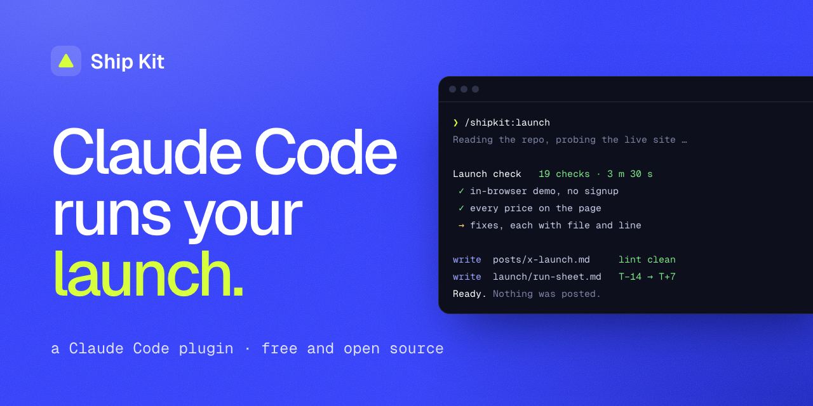

<p align="center"></p>

# Ship Kit

**Claude Code runs your launch.** Ship Kit is a Claude Code plugin for people who can build an app in a weekend and then freeze at "now post it".

This repo is the free half: three commands that work on any project.

| Command | What you get |
|---|---|
| `/shipkit:check` | A launch pre-flight. It reads your repo, probes your live site, and gives you a scored list of what will hurt the launch, with the exact fix for each item. |
| `/shipkit:page` | A landing page written from your repo: one HTML file in your brand, using your real screenshots and real facts, plus the share image, `llms.txt`, `sitemap.xml` and `robots.txt`. |
| `/shipkit:lint` | A second reader for any launch post. A linter flags AI and hype tells. An independent critic reads the post as that platform's crowd. Then it's checked against the subreddit's dated rules: self-promotion, AI-written posts and banned product types. You get a verdict, a score, the weakest line and fixes in your own words. |

It never posts, deploys or signs up for anything. Everything it writes goes in `.shipkit/` in your project.

## Why it exists

Launching is a second job. You need the page, the posts for every platform and their rules, the timing, the links and the checks. Most of it gets done at 2 AM the night before.

The marketing skill packs I tried teach launch frameworks. Ship Kit looks at *your* launch: it reads your repo and your live site, then hands you the fixes and the finished files. I built it while launching my own Mac app, Afterword, and ran it on that launch first.

## Install

In Claude Code:

```
/plugin marketplace add kiznnnn/shipkit
/plugin install shipkit@shipkit
```

You'll need Node 18 or newer for the check's site probe and the copy linter. Neither has any dependencies.

## Use

Open your project in Claude Code and type:

```
/shipkit:check
```

You get `.shipkit/check.md`: blockers, fixes for this week, what's already good, and the questions only you can answer, all ending in a one-line score you can share (`Launch check: <passed>/<scored>`). Then:

```
/shipkit:page
```

You get `.shipkit/page/index.html`. Open it, react to the words, and ship it wherever you host.

Before you post anything, paste it in and ask:

```
/shipkit:lint  is this tweet cringe?
```

Or just ask "does this sound like AI?" or "will this get removed from r/SideProject?". The fixed copy goes in `.shipkit/drafts/`, next to your original, which is never touched.

The commands share one product file, `.shipkit/product.md`, built from your repo. Every fact in it has a source, so Claude never invents a testimonial, a user count or a feature.

## Ship Kit Pro

Pro adds the part you need on launch day and every week after:

- `/shipkit:posts`: launch posts in your voice. For X, a thread, a 15-second video shot list and a week of follow-ups. One Reddit post per subreddit, written for its current rules. A Show HN (only if you qualify), Product Hunt, directories and personal messages. Subreddits come from a dated database of 44 launch places, with warnings for communities that remove AI-written posts or ban your kind of product. Every draft goes through the linter and the critic.
- `/shipkit:seo`: a weekly agentic SEO loop that runs free keyword research, writes one page with first-hand substance, QAs it, stages it for publishing and audits earlier pages.
- `/shipkit:launch`: the one command. It runs check, page and posts. Then it writes a dated run sheet from T−14 to T+7, UTM links, a directory plan, a tracker and a launch kit page with copy buttons.
- `/shipkit:recap`: after launch week, the real totals from your tracker and a check of every directory listing and backlink. Then a results post in your voice and a 1200×675 receipts card to post with it.

**Get Pro:** https://zione8t.gumroad.com/l/shipkit. The first 25 copies are $9, the next 50 are $19, then $29.

## License

MIT for this repo.
